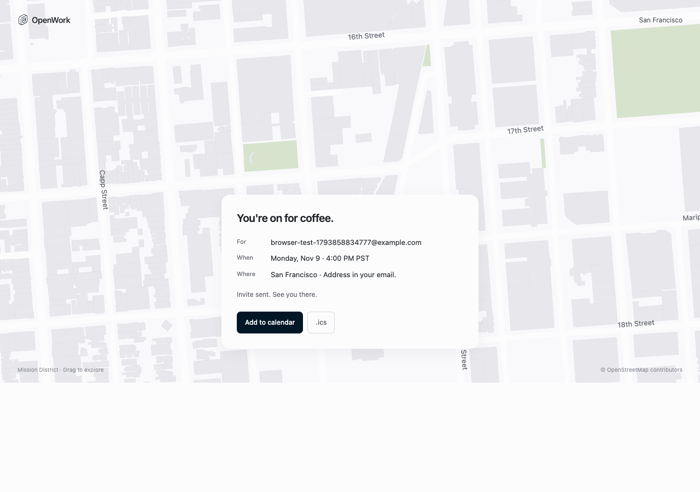

# ☕ coffee.openworklabs.com/sf

Grab a coffee with the OpenWork team in San Francisco, from inside your agent.

Add one URL to Claude Code, Cursor, Codex, OpenWork or any MCP client, then say
**"grab a coffee with OpenWork."** A small 3D San Francisco café opens right in
the chat ([MCP Apps](https://github.com/modelcontextprotocol/ext-apps)). Put
your email address in it, confirm the email, and you get a time, a place and a
calendar invite. The team gets a post in `#coffee-requests`.



## Add it to your agent

No API key, no sign-in. The URL is `https://coffee.openworklabs.com/sf`.

| Client | How |
|---|---|
| Claude Code | `claude mcp add --transport http coffee https://coffee.openworklabs.com/sf` |
| Cursor | "Add to Cursor" on the landing page, or `{"mcpServers":{"coffee":{"url":"https://coffee.openworklabs.com/sf"}}}` in `~/.cursor/mcp.json` |
| Codex | `[mcp_servers.coffee]` + `url = "https://coffee.openworklabs.com/sf"` in `~/.codex/config.toml` |
| VS Code | `code --add-mcp '{"name":"coffee","type":"http","url":"https://coffee.openworklabs.com/sf"}'` |
| OpenWork | Settings → Connectors → Add custom MCP → paste the URL |
| Claude.ai / ChatGPT | Settings → Connectors → Add custom connector → paste the URL |

Opening the same URL in a browser shows the landing page with the same 3D card,
so it works without an agent too.

## How it works

```
agent ──grab_coffee──▶ Worker (/sf) ──▶ 3D card (ui://coffee/sf.html)
                          │
person puts email ────────┤──▶ confirmation email (Cloudflare Email Service)
                          │
person taps confirm ──────┴──▶ next open slot ─▶ invite + .ics ─▶ #coffee-requests
                                                     ▲
                       the card in chat flips to "You're on for coffee" on its own
```

| Tool | What it does |
|---|---|
| `grab_coffee({ email?, note? })` | Shows the 3D card. With an email, sends the confirmation right away. |
| `coffee_status({ requestId })` | Is it booked yet? Returns the time and place. |

Design choices:

- **The email is confirmed before anything is booked**, so nobody can book coffee for someone else's address. The confirm link opens a page with a button; visiting it alone books nothing, so email link scanners can't confirm.
- **One proposed time**, the next free weekday slot (10:00, 14:00 or 16:00 PT, at least 18 hours out). Two people never get the same slot. "Can't make it?" is a reply to the email.
- **Rate limits** per email (3 a day) and per IP (20 an hour).
- **One self-contained HTML file** (Three.js, no external requests) serves as both the MCP App resource and the landing page, so the default MCP Apps CSP is enough. It respects `prefers-reduced-motion`, pauses when off screen, and stacks the card under the scene on phones.
- Hosts without MCP Apps still work: the tool text tells the agent to ask for the email.

Full experience design: [docs/DESIGN.md](docs/DESIGN.md).

## Develop

```bash
pnpm install
cp .dev.vars.example .dev.vars   # DEV_MODE=1 shows a "Dev: confirm link" instead of emailing
pnpm dev                         # http://localhost:8787/sf
pnpm test                        # unit + MCP-over-HTTP + web flow tests
pnpm typecheck
```

Try it from an agent locally: `claude mcp add --transport http coffee-dev http://localhost:8787/sf`.

## Deploy (Cloudflare)

Live at **https://coffee.openworklabs.com/sf** (Worker `coffee-mcp` in the OpenWork Labs account).

```bash
pnpm wrangler login
pnpm wrangler secret put SLACK_WEBHOOK_URL   # see slack-app-manifest.yaml
pnpm wrangler secret put HOST_EMAIL          # optional: CC'd and reply-to on every invite
pnpm deploy
```

- **Domain:** `coffee.openworklabs.com` is a Worker custom domain on the `openworklabs.com` zone.
- **Storage:** the `COFFEE_KV` namespace was provisioned on first deploy.
- **Email:** sent with the Cloudflare Email Service `EMAIL` binding from `hello@coffee.openworklabs.com`. The subdomain is onboarded for sending (SPF, DKIM, DMARC on the subdomain only; apex mail is untouched). Remove the binding and set `RESEND_API_KEY` to use Resend instead.
- **Config:** host name, café, time zone and sender live in `vars`.

### Slack

Bookings post to `#coffee-requests`. Create the app from
[`slack-app-manifest.yaml`](slack-app-manifest.yaml), install it to
`#coffee-requests`, and save the webhook as `SLACK_WEBHOOK_URL`. A bot token
works too: set `SLACK_BOT_TOKEN` and `SLACK_CHANNEL_ID`.

## Layout

```
app/        the 3D view (Three.js + @modelcontextprotocol/ext-apps), built to dist/app.html
src/        the Worker: MCP server, booking logic, email, Slack, calendar
test/       vitest
```

MIT licensed.
