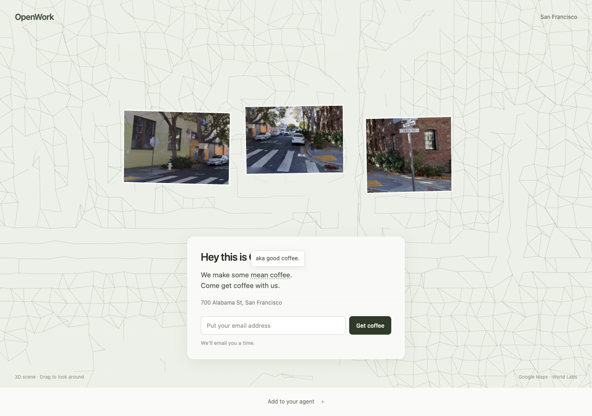

# Coffee with OpenWork / SF

**Hey this is OpenWork. We make some mean coffee. Come get coffee with us.**

Live: **https://coffee.openworklabs.com/sf** · Meet us at **700 Alabama St, San Francisco**.

Add one URL to your agent. Tell it your email, and say **“grab a coffee with OpenWork.”** It books and sends an invite. No forms or confirmation clicks required. The optional MCP App shows your booking over a light street wireframe derived from the SF reconstruction, with floating crops of the actual source image.



## Add it to your agent

No API key, no sign-in. URL: `https://coffee.openworklabs.com/sf`.

| Client | Setup |
|---|---|
| Claude Code | `claude mcp add --transport http coffee https://coffee.openworklabs.com/sf` |
| Cursor | Add-to-Cursor button on the landing page, or `{"mcpServers":{"coffee":{"url":"https://coffee.openworklabs.com/sf"}}}` in `~/.cursor/mcp.json` |
| Codex | `[mcp_servers.coffee]` and `url = "https://coffee.openworklabs.com/sf"` in `~/.codex/config.toml` |
| VS Code | `code --add-mcp '{"name":"coffee","type":"http","url":"https://coffee.openworklabs.com/sf"}'` |
| OpenWork | Library → Add to library → Connector → Add an MCP → URL → No sign-in |
| Other MCP clients | Add a remote Streamable HTTP server with the URL above |

Opening that same URL in a browser shows the invitation and setup instructions. The standalone web form retains email verification; agents don't need it.

## Two tools, no required UI

| Tool | Behavior |
|---|---|
| `grab_coffee({})` | Returns `ask_email`, opens an empty form, no side effects. The agent asks for an email in chat. |
| `grab_coffee({ email, note? })` | Immediately reserves the next available configured time and attempts to email a calendar invite. Returns the booking fields and delivery outcome. |
| `coffee_status({ requestId })` | Returns the reservation, calendar links and invitation-delivery outcome. |

The agent must only pass an email the user gave for booking coffee. `inviteDelivery: "sent"` means the provider accepted the email, **not** that it reached the inbox. Failed or unknown delivery is shown honestly, with calendar links still available. Repeated calls reuse an existing future booking without emailing again.

The view consumes the tool's `structuredContent`. No click, hidden browser workflow or second booking call is needed to fill it. Hosts without MCP Apps still receive all details as text and structured data.

## Real neighborhood, not a mock

The environment comes from the public user-created Marble world [Urban Intersection in San Francisco](https://marble.worldlabs.ai/world/65f3661f-de05-44f3-a9b8-7fcaa142d0ec). `app/world.ts` points at its public 150k-splat export and source image. `app/street.ts` derives an approximate wireframe from adjacent depth samples and places three crops of that single source image in 3D. These are not three separate photographs, and the wireframe is not a surveyed building mesh. Google Maps source attribution remains visible. No World Labs API credential is included in the browser, Worker or repository.

The 3D scene is optional: failure to load it never blocks booking. Reduced-motion stops the camera drift and UI animations. **Mean coffee** reveals **aka good coffee.** on hover or keyboard focus.

Full experience and limitations: [docs/DESIGN.md](docs/DESIGN.md).

## Development and tests

```sh
pnpm install
cp .dev.vars.example .dev.vars
pnpm dev                         # http://localhost:8787/sf
pnpm test                        # unit + real MCP-over-HTTP and web routing
pnpm typecheck
pnpm exec playwright install chromium
pnpm test:ui                     # real splat + MCP Apps CSP + filled receipt, no clicks
```

To use system Chrome for browser tests on macOS:

```sh
COFFEE_CHROME_PATH="/Applications/Google Chrome.app/Contents/MacOS/Google Chrome" pnpm test:ui
```

Browser tests use the local Workers email simulator, never real recipients. They implement a small MCP Apps test host with the same restrictive CSP as OpenWork, so a renderer that only works outside chat doesn't pass.

## Deploy on Cloudflare

```sh
pnpm exec wrangler login
pnpm exec wrangler secret put SLACK_WEBHOOK_URL
pnpm exec wrangler secret put HOST_EMAIL     # optional: CC + reply-to
pnpm deploy
```

The Worker `coffee-mcp` runs in the OpenWork Labs account on `coffee.openworklabs.com`. `COFFEE_KV` is pinned to its production namespace. The `EMAIL` binding sends through Cloudflare Email Service from `hello@coffee.openworklabs.com`; SPF, DKIM and DMARC are on the coffee subdomain, not the apex. Resend remains an optional fallback if the binding is removed.

### Slack

Create an app from [`slack-app-manifest.yaml`](slack-app-manifest.yaml), install it to `#coffee-requests`, then save its URL as `SLACK_WEBHOOK_URL`. Alternatively set `SLACK_BOT_TOKEN` and `SLACK_CHANNEL_ID`. Posting an intro manually doesn't configure the Worker's automatic posts.

### Scheduling / abuse limits

Configured weekday slots are 10:00, 14:00 and 16:00 Pacific, at least 18 hours out. This is not connected to a host's live calendar. KV handles sequential reuse and rate-limit damping, **not** transactional concurrency: move reservations into a Durable Object before broad public promotion. Per-email and per-IP limits apply. Protect or disable the public endpoint if abuse occurs.

## Files

- `app/`: the invitation, splat scene, MCP Apps client and setup instructions.
- `src/`: Cloudflare Worker, MCP tools, reservations, email, Slack and calendar files.
- `test/`: unit and MCP-over-HTTP tests.
- `ui/`: browser tests for the real scene and MCP-only/no-click flow.

MIT licensed. Third-party notices: [docs/THIRD_PARTY.md](docs/THIRD_PARTY.md).
